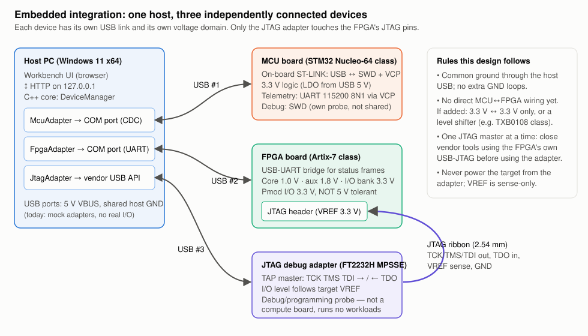

# Embedded-system integration design

Goal: one host PC that can talk to **one microcontroller board, one FPGA board and one JTAG debug adapter**, each through its own adapter in software, without assuming they share a connector, voltage or protocol. Today the adapters are C++ mocks (`src/core/hardware`); the design below is what the real versions would plug into.



## 1. Assumed boards

Pinouts and voltages below are **assumptions for these specific board classes** and must be checked against each board's user manual before wiring anything.

| Role | Assumed board | Why this class |
|---|---|---|
| Microcontroller | STM32 Nucleo-64 (e.g. NUCLEO-F446RE) | On-board ST-LINK gives USB power, a virtual COM port and SWD debug over one cable |
| FPGA | Artix-7 dev board (e.g. Digilent Arty A7-35T, XC7A35T) | USB-UART bridge for status frames; 3.3 V Pmod I/O |
| JTAG adapter | FT2232H-based adapter in MPSSE mode | Common, documented, scriptable; JTAG on channel A |

## 2. Interface and pin/voltage table

| Link | Signals | Driven by → to | Logic level | Connector | Notes / assumptions |
|---|---|---|---|---|---|
| Host ↔ MCU | USB D+/D−, VBUS, GND | host ↔ ST-LINK | USB; board makes 3.3 V from 5 V VBUS | USB (Mini/Micro-B, by revision) | ST-LINK exposes a virtual COM port wired to the MCU's USART2 (PA2 TX / PA3 RX on Nucleo-64): 115200 8N1 telemetry |
| MCU debug | SWDIO, SWCLK, NRST | on-board ST-LINK → MCU | 3.3 V | internal to the board | Owned by ST-LINK only; **not** connected to the shared JTAG adapter |
| Host ↔ FPGA | USB D+/D−, VBUS, GND | host ↔ on-board FTDI bridge | USB; board regulators make 1.0 V core, 1.8 V aux, 3.3 V I/O | USB Micro-B | UART status frames from soft logic, 115200 8N1. Heavy designs may need the board's external supply instead of USB power |
| Host ↔ JTAG adapter | USB D+/D−, VBUS, GND | host ↔ FT2232H | USB 2.0 Hi-Speed | USB | Driven through the vendor D2XX/libftdi API, not a COM port |
| JTAG adapter ↔ FPGA | TCK, TMS, TDI (out); TDO (in); VREF (sense); GND | adapter → FPGA TAP; TDO from FPGA | **follows VREF** = FPGA config bank VCCO (3.3 V assumed) | 2.54 mm JTAG header (6-pin VREF/GND/TCK/TDO/TDI/TMS assumed) | FT2232H MPSSE mapping: ADBUS0 = TCK, ADBUS1 = TDI, ADBUS2 = TDO, ADBUS3 = TMS. TRST/SRST not used |
| MCU ↔ FPGA (future, optional) | UART or SPI | either way | 3.3 V ↔ 3.3 V | jumper wires to Pmod | Not part of this design yet. If added: common GND first; direct only when both sides are 3.3 V; otherwise a bidirectional level shifter (e.g. TXB0108 class). FPGA Pmod pins are **not 5 V tolerant** |

**Power and grounding.** Each board takes power from its own USB port (≤ 500 mA on USB 2.0). All grounds meet at the host through the USB cables, which is the only ground reference in this design. Nothing is powered *from* the JTAG adapter: its VREF pin only senses the target voltage. If the FPGA later needs an external supply, it shares ground with the host through its USB cable; avoid adding a second ground path (e.g. a separate bench supply ground strap) that would form a loop.

**Voltage domains.** MCU I/O 3.3 V (many STM32 pins are 5 V tolerant, but that is per-pin and not relied on). FPGA core 1.0 V and aux 1.8 V are internal only; user I/O banks used here are 3.3 V. The JTAG adapter's I/O must match the FPGA config bank: a plain FT2232H drives 3.3 V, so a 1.8 V or 2.5 V target would need a buffer powered from VREF (e.g. a 74LVC/SN74AVC-class translator). Level shifting is therefore needed **only** if a non-3.3 V target or a 5 V MCU is ever used.

## 3. JTAG signal ownership, and why the adapter is not a "board"

- A JTAG TAP has exactly **one master**. TCK, TMS and TDI are driven by the adapter; TDO is driven by the FPGA. The FPGA board's own USB-JTAG bridge (if it has one) drives the same TAP, so only one of the two may be active: close vendor tools using the on-board path before the external adapter connects. The software models this as a single owner per TAP.
- The MCU is *not* on this JTAG chain. Its SWD port belongs to its own ST-LINK.

The JTAG adapter is a **debug and programming interface**, not an interchangeable compute board:

- It runs no user code and has no application I/O. It is a protocol bridge from USB to a TAP state machine, so its "capabilities" are scan-chain detection, IDCODE readout, boundary scan and configuration download.
- Its pins only have meaning when connected to a TAP, and their voltage is set by the *target*, not by the adapter.
- So the software gives it its own `DeviceKind::JtagAdapter` with debug capabilities (see the mock's `"not-compute"` capability). It is never offered as a target for workloads or telemetry beyond link health (VREF, TCK rate, IDCODE).

## 4. Software design (implemented as mocks)

```
DeviceAdapter (interface)              DeviceManager (one mutex, used by HTTP threads)
 ├─ info(), capabilities(), state()     ├─ discover()  -> 3 adapters
 ├─ connect(), disconnect()             ├─ connect / disconnect / readTelemetry by id
 ├─ readTelemetry()                     └─ injectFault / recover (simulation hooks)
 ├─ injectFault(), recover()
 └─ MockMicrocontroller | MockFpga | MockJtagAdapter
```

- **State machine:** `Disconnected → Connected → Faulted → (Recover) → Connected`. A faulted device refuses `connect()` and telemetry until `recover()` is called, so a fault can't be silently ignored.
- **Telemetry:** one message type (`deviceId`, sequence number, host time, list of named fields with units). Values are deterministic (fixed-seed noise), so tests are repeatable. Everything is labelled `simulated: true`, and the UI shows a SIMULATED banner and badge.
- **Faults:** *timeout* (no answer within 500 ms; recover in one attempt) and *link drop* (USB unplugged; the mock needs two attempts, like a real port that is still re-enumerating). A fault on one device never affects the others (tested).
- **Replacing a mock:** a real `SerialMcuAdapter` would open the COM port with `CreateFileW` + `SetCommState` (115200 8N1) and `SetCommTimeouts` for the 500 ms read timeout; a `FtdiJtagAdapter` would use D2XX `FT_Open` + MPSSE commands. The UI and `DeviceManager` would not change.

## 5. Safe integration plan

1. **Mocks first** (done): UI, state machine, timeouts and recovery proven with no hardware.
2. **Each board alone** with its vendor tool (STM32CubeProgrammer, Vivado Hardware Manager) to confirm it works before the workbench touches it.
3. **Measure before connecting:** with a multimeter, check the FPGA JTAG header VREF and the Pmod VCC (expect 3.3 V). Check the adapter's I/O level setting matches.
4. **Connect JTAG with power off**, ground first; then power the FPGA board, then plug in the adapter's USB.
5. **Read-only first:** scan the chain and read the IDCODE (expect `0x0362D093` for XC7A35T). No programming until that is right.
6. **Swap one mock at a time** for a real adapter, keeping the same timeouts and recovery path, and run the same UI checks.
7. Only then consider an MCU↔FPGA data link (same voltage, common ground, series resistors on the first try).
8. General care: ESD strap, no hot-plugging of header wires, current-limited supply if an external one is used.

## 6. Limitations

- No real I/O: no serial, USB or JTAG traffic is generated; telemetry formats and values are invented.
- Pinouts and voltages are assumptions for the named board classes, to be verified per board revision.
- No firmware, bitstream or FPGA programming is included (out of scope).
- The mock "attempt" count for recovery is modelled, not measured.
