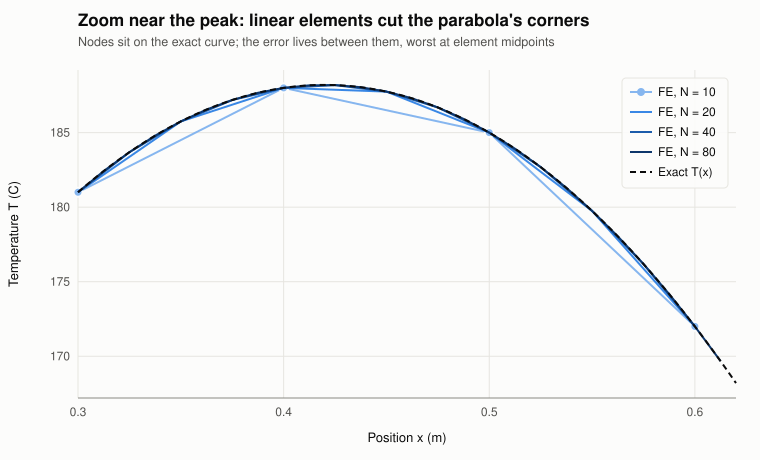
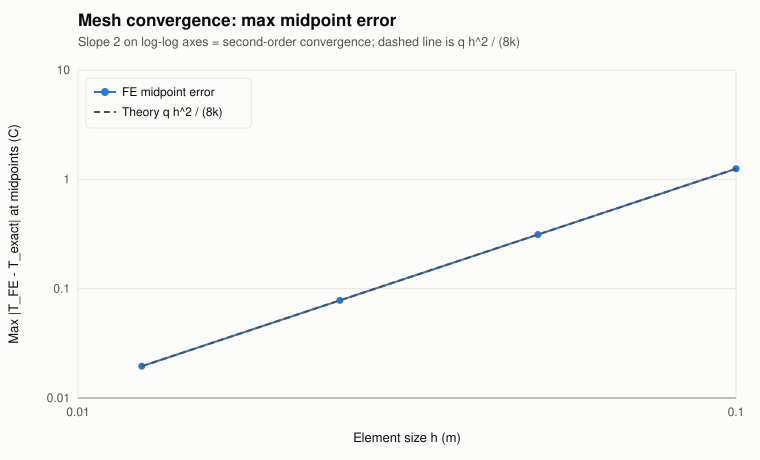
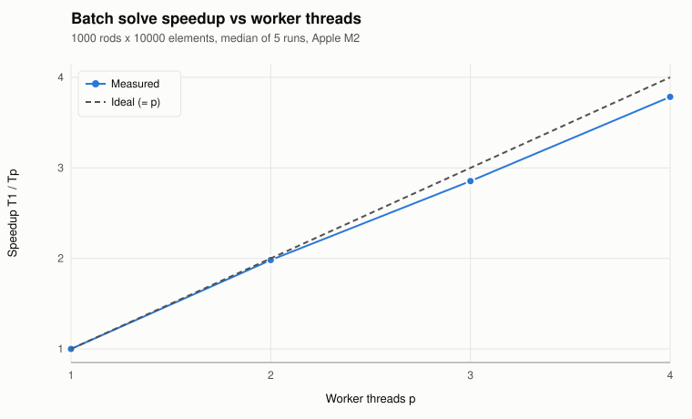
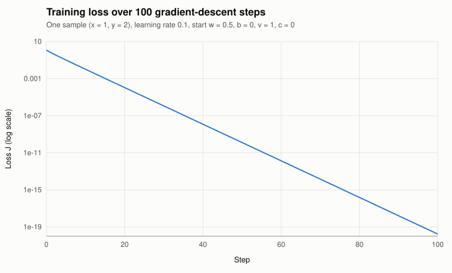

# Unified Engineering Workbench: project report

Candidate RA2311003011475 · PASS Science Works R&D internship 2026–27

Appendix (separate, ≤ 2 pages): handwritten backpropagation derivation in `docs/handwritten/`.

## 1. Design choices

**One C++ executable, browser as the screen.** `Launch.exe` is a C++17 program that embeds a small HTTP server (cpp-httplib), binds to `127.0.0.1` only and opens the default browser. Windows 11 always has a browser, so this gives a full UI (3D, plots, tables) with nothing to install. The alternatives were weighed: a WebView2 window adds a runtime dependency, and an ImGui desktop app would mean writing 3D picking and plotting from scratch.

**Strict layering.**

| Layer | Folder | Knows about |
|---|---|---|
| Core | `src/core` | numbers, files, threads. No HTTP, no JSON, no UI |
| Transport | `src/app` | HTTP routes, JSON conversion, background jobs |
| Presentation | `src/web` | display only: no parsing, no physics |

The core is a static library used by three front ends: the server, the unit tests and the results generator. So the numbers in `results/` and in the UI come from the same functions, and CSV exports are built once in `core/report`.

**Errors the user can act on.** Every failure is a `WorkbenchError{code, message}` whose message says what is wrong and what to do ("CSV line 7: node_id 12 appears twice. Each node must be listed once."). The transport maps codes to HTTP 400/409/500 and the UI shows the text next to the control that caused it. Browser-side checks only give early feedback; the C++ side always re-validates.

**Responsiveness and cancellation.** HTTP requests are served by a thread pool, and long work runs in `JobManager` on its own thread. The UI polls progress every 250 ms and can cancel. Cancellation is cooperative: the core checks a `CancelToken` between independent rod solves. A cancelled run is reported as cancelled and its partial results are discarded, so nothing half-finished is exported. Exports use write-to-temp-then-rename, so a crash can't leave a truncated file. Only one job runs at a time on purpose, because two benchmarks sharing cores would corrupt each other's timings.

**Delivery.** The release is cross-compiled with llvm-mingw (clang 23, UCRT) using `-static`, so the exe imports only OS DLLs (KERNEL32, WS2_32, SHELL32, ADVAPI32, UCRT). UI files are served with `std::filesystem` paths, so extracting into a folder with non-ASCII characters still works. A CI workflow (`.github/workflows/windows.yml`) is set up to build the same sources with MSVC on a clean Windows runner and run the tests plus `Launch.exe --smoke-test`.

## 2. Thermal FEA: formulation and verification

**Problem.** Steady conduction in a uniform rod with insulated sides and uniform heat generation:
−d/dx(kA dT/dx) = qA on 0 < x < L, T(0) = 100 °C, T(L) = 20 °C, with L = 1 m, A = 1e-4 m², k = 10 W/(m·K), q = 10 000 W/m³. SI units throughout; Celsius is fine because only temperature *differences* appear in the equation.

**Discretisation.** N two-node linear elements of size h = L/N. The weak form gives, per element:

- stiffness k_e = (kA/h)·[1 −1; −1 1]
- load f_e = (qAh/2)·[1; 1]. This is the exact integral of qA·Nᵢ over the element because q is uniform.

Element contributions are added into a global tridiagonal system (`assemble()` loops over elements, as the brief requires, rather than writing the global matrix directly).

**Boundary conditions.** Both temperatures are prescribed. For each fixed node, the known value times its matrix coefficient is moved to the neighbour's right-hand side, and the node's row is replaced by 1·T = value. This keeps the matrix symmetric positive definite, so the Thomas algorithm (O(N), no pivoting) is stable. A zero or non-finite pivot raises a `NumericalFailure`.

**Exact solution.** T(x) = 100 − 80x/L + [q/(2k)]·x(L − x). Its peak is ≈ 188.2 °C at x = 0.42 m.

**Results** (`results/fea_convergence.csv`, `fea_midpoints.csv`, `fea_solutions.csv`, plots `fea_temperature_profiles.svg`, `fea_temperature_zoom.svg`, `fea_convergence.svg`):

| N | h (m) | max midpoint error (°C) | q·h²/(8k) | max nodal error (°C) | observed order |
|---|---|---|---|---|---|
| 10 | 0.1 | 1.2500 | 1.25 | 5.7e-14 | — |
| 20 | 0.05 | 0.3125 | 0.3125 | 2.0e-13 | 2.000 |
| 40 | 0.025 | 0.078125 | 0.078125 | 7.7e-13 | 2.000 |
| 80 | 0.0125 | 0.019531 | 0.019531 | 1.3e-12 | 2.000 |

Midpoint values use the FE interpolation (Tᵢ + Tᵢ₊₁)/2, not the exact function. The error falls 4× each time h halves: second-order convergence. It matches the closed form exactly. The exact solution is a parabola, the FE solution is its linear interpolant through exact nodal values, and the gap of a chord under a parabola at its midpoint is (q/2k)(h/2)² = q·h²/(8k). Every mesh has the same error at every midpoint, because the parabola's curvature is constant.

**Debugging insight.** The first check compared FE and exact values at the nodes and got ~1e-13 for every N. That looked like a perfect solver, but it hides the discretisation error entirely. For 1D linear elements with consistent loads, the nodal values are exact (the Green's function of this operator is piecewise linear), so the error only exists *between* nodes. That is why the brief asks for midpoint error. A second trap was N = 1: there are no free nodes, and the error 125 °C equals q·L²/(8k), a useful edge-case test. Nodal error grows slowly from 6e-14 to 1.3e-12 as N increases: that is round-off accumulating in the elimination, not discretisation error.

**Assumptions.** Steady state; constant k, A, q; no lateral losses; no contact resistance at the ends; small enough temperatures that k does not vary. Tests also cover q = 0 (exactly linear profile), invalid L/A/k ≤ 0, NaN/Inf, and N outside [1, 10⁷].

**Figures** (generated by `wb_results`, raw data in `results/`):

 

## 3. CAD / ANSYS data visualisation

Both readers are hand-written in C++ (`core/io`). The STL reader is a small tokenizer plus state machine that tracks line numbers. It accepts any letter case, CRLF line endings, scientific notation and several solids per file. It recomputes zero normals from the winding order and counts zero-area facets. It rejects binary STL (detected by control bytes, since some binary files start with "solid") along with truncated files, NaN/Inf and wrong vertex counts. The CSV reader requires the exact header `node_id,x_m,y_m,z_m,temperature_C`. It accepts `#` comments, a BOM and CRLF, and rejects wrong column counts, non-numeric or non-finite values, non-integer or duplicate ids, quotes, and T < −273.15 °C. Empty, whitespace-only and header-only files get a specific `EmptyFile` message.

In the UI the STL is drawn with three.js (rotate, pan, zoom, fit-to-view, wireframe toggle). STL has no units, so a units selector (mm/m/in) scales it into metres. With the example files, which are the same self-made heat sink in mm and m, the mesh and the point cloud then line up. Nodes are coloured with a single-hue warm ramp (no rainbow), with a legend in °C. Hovering shows node id, coordinates in metres and temperature; clicking pins the node. Tested limits: 64 MB / 1 M records; 500 k triangles parse in 0.24 s and 1 M CSV rows in 0.19 s (`results/io_size_limits.csv`). Both example files are self-created; the CSV is labelled **SYNTHETIC** in its header comments and in the UI (`data/PROVENANCE.md`).

## 4. Multicore performance

**Workload.** 1 000 independent rods × 10 000 elements. k ∈ [1, 400] W/(m·K) and q ∈ [10³, 10⁵] W/m³ come from `std::mt19937_64` with seed 20260101. Raw 64-bit draws are mapped to [0, 1) by hand, because `std::uniform_real_distribution` gives different numbers on MSVC, libstdc++ and libc++; a test pins the first case. Serial and parallel versions call the same `fea::solve` on the same vector of cases.

**Parallel design.** A bounded pool of p `std::thread`s pulls case indices from an atomic counter (dynamic load balancing). Each thread writes only to its own pre-allocated result slot, so there are no locks on results and the output is in input order regardless of finishing order. The first exception stops the pool and is rethrown after all threads join.

**Method.** Generation happens once, outside timing. Each configuration gets 1 warm-up run and 5 measured runs on `std::chrono::steady_clock` around the compute call only. The median is reported. T₁ is the pool with one worker, so pool overhead cancels out of the speedup; the plain serial loop is listed for reference.

**Machine (development host).** Apple M2: 8 cores (4 performance + 4 efficiency), 8 logical CPUs, 16 GiB RAM, macOS, Clang 21, `-O3 -DNDEBUG` (`results/system_info.txt`).

| Mode | median (ms) | speedup T₁/Tₚ | efficiency | max \|ΔT\| vs serial (°C) |
|---|---|---|---|---|
| serial loop | 127.5 | n/a | n/a | 0 |
| pool, p = 1 | 129.5 | 1.00 | 1.00 | 0 |
| pool, p = 2 | 65.3 | 1.98 | 0.99 | 0 |
| pool, p = 3 | 45.4 | 2.85 | 0.95 | 0 |
| pool, p = 4 | 34.2 | 3.78 | 0.95 | 0 |

 

**Analysis.** Agreement is bit-exact (0 °C, well inside the 1e-8 requirement), as it should be: every case runs the same instructions in the same order whatever thread runs it. Scaling is close to linear up to 4 workers because the cases are independent and each is ~130 µs of work, far more than the cost of one atomic increment. Efficiency drops to ~0.95 at p = 3–4 for three likely reasons, not separately measured:
- memory bandwidth: each solve streams five arrays of 10 001 doubles;
- creating the p threads at the start of every run (the pool is not reused between runs);
- the M2's mixed core types and turbo behaviour.

Small batches (e.g. 37 cases × 300 elements in the tests) would be dominated by thread creation. **Limitations:** these numbers are from the Mac, not the target Windows PC. The UI's Performance view and `tools\wb_results.exe` record the grading machine's own CPU, cores, RAM, compiler and flags in the CSV. On a single-logical-CPU machine the parallel path still runs with one worker and the report says speedup cannot be assessed (tested with a CPU-count override).

**Launch-to-ready** is measured separately from compute. On Windows, `Launch.exe` measures from the OS process creation time (`GetProcessTimes`) to the server listening. Elsewhere it measures from `main()`. On the Mac this is ~2–3 ms. The browser page then reports when it is usable: 67–236 ms for the plain views in headless Chrome, and 2.4 s in one run that also loaded both example files and started WebGL with software rendering. Both values are shown in the Performance view and printed in the console.

## 5. Embedded integration (summary of `docs/EMBEDDED_DESIGN.md`)

The host connects to each device over its **own** USB link:
- **MCU (STM32 Nucleo-64 class):** 3.3 V logic; virtual COM port for telemetry; SWD owned by its on-board ST-LINK.
- **FPGA (Artix-7 class):** 1.0/1.8/3.3 V domains; Pmod pins not 5 V tolerant; USB-UART for status frames.
- **JTAG adapter (FT2232H MPSSE):** drives TCK/TMS/TDI, reads TDO, and follows the target's VREF.

Grounds meet only at the host. Level shifting is needed only for a non-3.3 V target or a 5 V MCU. A TAP has one master, so the adapter and the FPGA's on-board USB-JTAG must never be active together. The adapter is a debug/programming bridge with no compute role, so the software gives it its own device kind with debug-only capabilities.

The C++ mocks implement discovery, capabilities, a `Disconnected → Connected → Faulted → Recover` state machine, a typed telemetry message, and two injectable faults: a timeout, and a link drop that needs a retry. All are labelled SIMULATED in the data and the UI. A staged plan (measure VREF, read the IDCODE before programming, swap one mock at a time) is in the design doc.

## 6. Backpropagation

**Forward pass** with w = 0.5, b = 0, v = 1, c = 0, x = 1, y = 2:
- z = 0.5, h = tanh 0.5 = 0.462117
- ŷ = 0.462117, e = ŷ − y = −1.537883, J = 1.182542

**Gradients.** With e = ŷ − y and dh/dz = 1 − h²:

| Parameter | Formula | Value |
|---|---|---|
| c | ∂J/∂c = e | −1.537883 |
| v | ∂J/∂v = e·h | −0.710682 |
| b | ∂J/∂b = e·v·(1 − h²) | −1.209464 |
| w | ∂J/∂w = e·v·(1 − h²)·x | −1.209464 |

**One update** (rate 0.1, all four gradients taken from the original parameters): w = 0.620946, b = 0.120946, v = 1.071068, c = 0.153788. J falls to 0.685774.

**Gradient direction.** All four gradients are negative because ŷ is below the target and ŷ increases with every parameter (x, v, h and 1 − h² are all positive). Descent therefore increases all four.

**C++ check** (`core/ml`, no autodiff): central differences with ε = 1e-6 agree to 5e-11 – 1.1e-10, well inside 1e-5 (`results/backprop_gradient_check.csv`).

**Loss over 100 steps** (`backprop_loss.svg`): 1.18 → 0.0102 after 10 steps → 1.3e-10 after 50 → 1.7e-20 after 100. On a log scale this is a straight line, a constant ratio of ≈ 0.633 per step. Four parameters fitting one sample is over-parameterised, so zero loss is reachable. Near the minimum the loss is close to quadratic, so gradient descent with a fixed rate converges geometrically. By step 100 the loss is at floating-point noise, and further steps change nothing meaningful.

## 7. Test outcomes

- **Unit tests:** 53/53 pass in `wb_tests` (≈ 0.4 s) on macOS/Clang. The same tests compile for Windows with llvm-mingw. The MSVC CI workflow is set up but runs only once the repository is pushed.
- **Smoke test:** `Launch --smoke-test` passes 10/10 HTTP checks, including two rejected inputs. Path-traversal attempts (`/../`, `%2e%2e`) return 404.
- **Scripted UI walkthrough** (`docs/WALKTHROUGH.md`): 13 real clicks and uploads through all five views in the light theme, plus screenshots in the dark theme. It covers node inspection, malformed-CSV rejection, a live benchmark, cancelling a batch mid-run (stopped after 3 695 of 20 000 cases) and timeout → recover on the hardware mocks.

Defects found and fixed during testing are listed in `docs/AI_USAGE_LOG.md` §3. They include:
- a form field name that silently broke the Run button;
- wrong reference constants;
- an overlay that never hid;
- crowded log-axis labels;
- a CSV helper that would have returned HTTP 500.

## 8. Limitations

- **Not yet tested on Windows:** the Windows build was not double-click tested on a physical Windows 11 PC during development (cross-compiled; imports verified; MSVC CI configured). That launch test must happen before submission.
- **Unsigned exe:** it is not code-signed, so SmartScreen may prompt once.
- **Mac benchmark numbers:** the reported benchmark is from the development Mac.
- **No mesh/result registration:** the mesh and the point cloud are not registered to each other (not required).
- **Interactive plot cap:** interactive FEA plots are capped at N ≤ 100 000.
- **Simulated hardware:** the hardware is simulated only.
- **Rendering not benchmarked:** browser rendering of very large STL/CSV files was not benchmarked.
