# Screenshot walkthrough (with logs)

Captured on 2026-10-31 on the development Mac (Apple M2, macOS) from a Release build of `Launch`, driven by headless Chrome in the light theme. Each step is a real click or upload in the running UI, scripted through the Chrome DevTools protocol (`scripts/ui_walkthrough.py`) so it is repeatable. Times are seconds since the browser opened the page.

**Not covered here:** double-clicking `Launch.exe` on Windows 11. That has to be shown on a Windows PC (video or screenshots of Explorer → Launch.exe → browser) before submission.

| t (s) | Step | What it shows |
|---|---|---|
| 3.2 | [01_geometry_empty](walkthrough/01_geometry_empty.png) | App opened by Launch; Geometry view, nothing loaded yet; status bar shows launch timing |
| 5.6 | [02_geometry_loaded](walkthrough/02_geometry_loaded.png) | Example STL (mm) and SYNTHETIC nodal CSV (m) loaded and parsed in C++; temperature legend in degC |
| 6.3 | [03_geometry_node_inspect](walkthrough/03_geometry_node_inspect.png) | Hovering/clicking a node shows its id, coordinates (m) and temperature (degC) |
| 7.0 | [04_geometry_malformed_csv](walkthrough/04_geometry_malformed_csv.png) | A CSV with a NaN temperature is rejected by the C++ reader with the line number and reason |
| 7.9 | [05_thermal_convergence](walkthrough/05_thermal_convergence.png) | Convergence study N=10,20,40,80: FE vs exact, log-log midpoint error (order 2), table |
| 8.5 | [06_thermal_validation](walkthrough/06_thermal_validation.png) | Invalid inputs (k = -5, N = 0) are flagged before anything is sent; the C++ side re-validates too |
| 10.4 | [07_performance_running](walkthrough/07_performance_running.png) | Benchmark running as a background job: progress bar, Cancel button, UI stays responsive |
| 12.9 | [08_performance_results](walkthrough/08_performance_results.png) | Benchmark finished: median times, speedup, efficiency, serial/parallel agreement <= 1e-8 degC |
| 13.5 | [09_performance_cancelled](walkthrough/09_performance_cancelled.png) | A long serial batch cancelled mid-run: partial results are discarded, nothing exported |
| 16.0 | [10_hardware_connected](walkthrough/10_hardware_connected.png) | Three SIMULATED devices discovered and connected; telemetry refreshes every second |
| 17.6 | [11_hardware_timeout](walkthrough/11_hardware_timeout.png) | Injected timeout on mcu0: link marked faulted with an actionable message; other devices unaffected |
| 19.2 | [12_hardware_recovered](walkthrough/12_hardware_recovered.png) | Recover: mcu0 reconnects, telemetry resumes from sequence 1; event log shows the sequence |
| 20.7 | [13_backprop](walkthrough/13_backprop.png) | Backprop: forward pass, one update, gradient check (all <= 1e-5) and 100-step loss curve |

### 01 geometry empty (t = 3.2 s)

App opened by Launch; Geometry view, nothing loaded yet; status bar shows launch timing

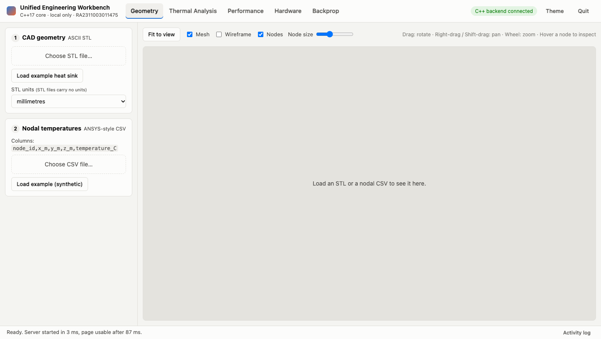

### 02 geometry loaded (t = 5.6 s)

Example STL (mm) and SYNTHETIC nodal CSV (m) loaded and parsed in C++; temperature legend in degC

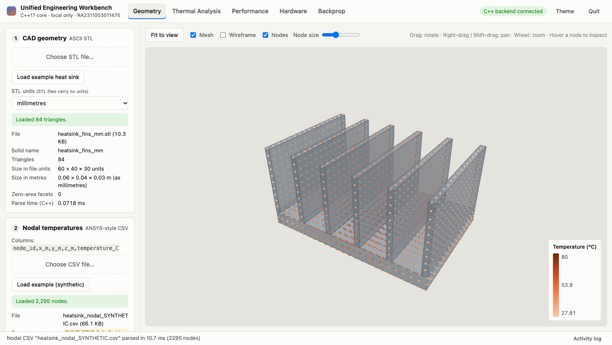

### 03 geometry node inspect (t = 6.3 s)

Hovering/clicking a node shows its id, coordinates (m) and temperature (degC)

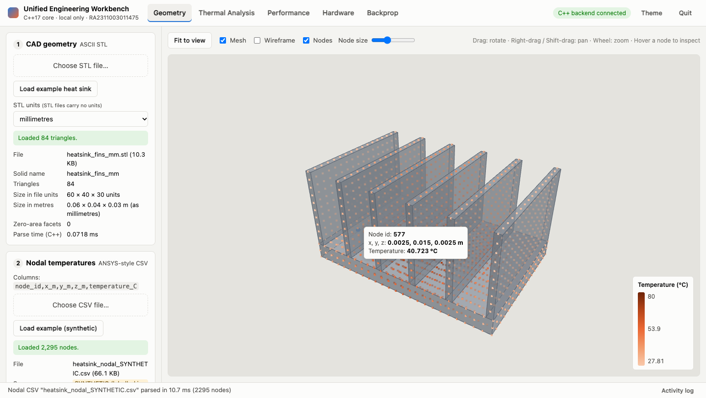

### 04 geometry malformed csv (t = 7.0 s)

A CSV with a NaN temperature is rejected by the C++ reader with the line number and reason

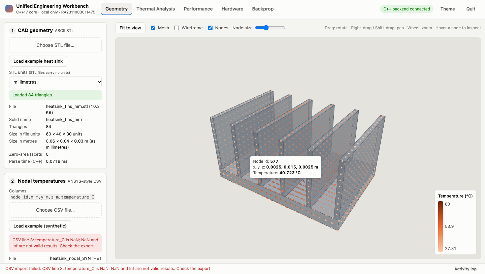

### 05 thermal convergence (t = 7.9 s)

Convergence study N=10,20,40,80: FE vs exact, log-log midpoint error (order 2), table

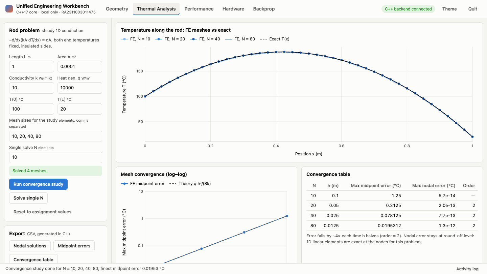

### 06 thermal validation (t = 8.5 s)

Invalid inputs (k = -5, N = 0) are flagged before anything is sent; the C++ side re-validates too

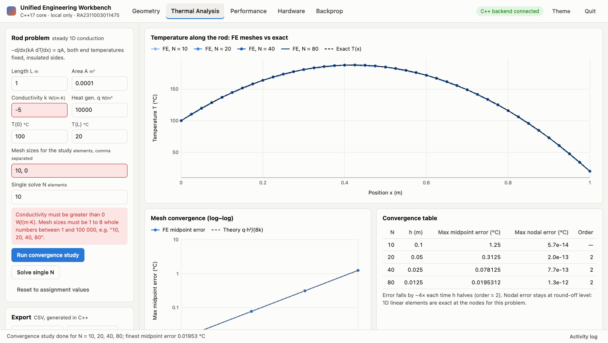

### 07 performance running (t = 10.4 s)

Benchmark running as a background job: progress bar, Cancel button, UI stays responsive

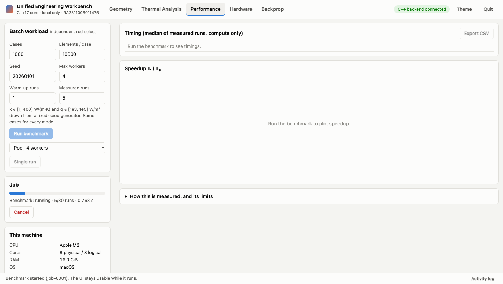

### 08 performance results (t = 12.9 s)

Benchmark finished: median times, speedup, efficiency, serial/parallel agreement <= 1e-8 degC

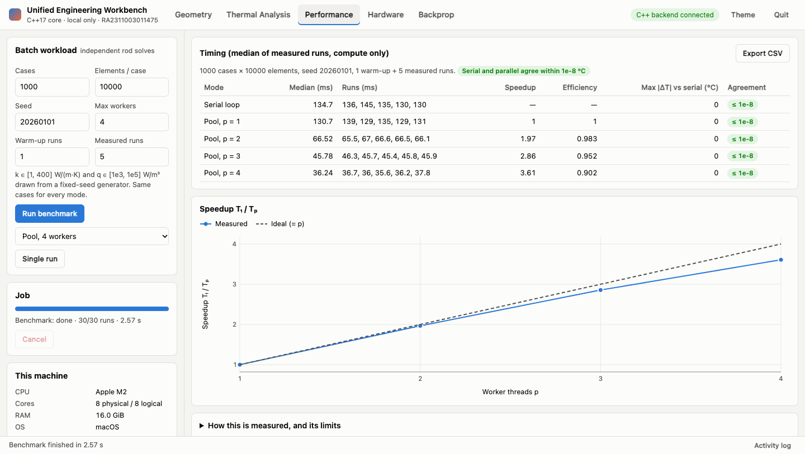

### 09 performance cancelled (t = 13.5 s)

A long serial batch cancelled mid-run: partial results are discarded, nothing exported

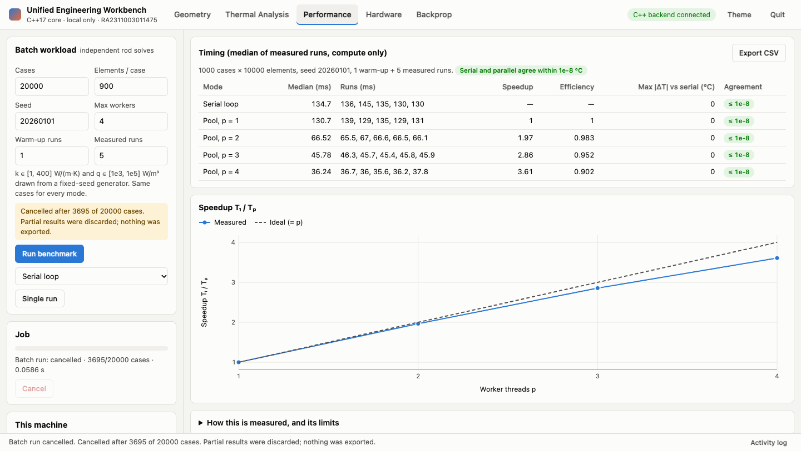

### 10 hardware connected (t = 16.0 s)

Three SIMULATED devices discovered and connected; telemetry refreshes every second


### 11 hardware timeout (t = 17.6 s)

Injected timeout on mcu0: link marked faulted with an actionable message; other devices unaffected

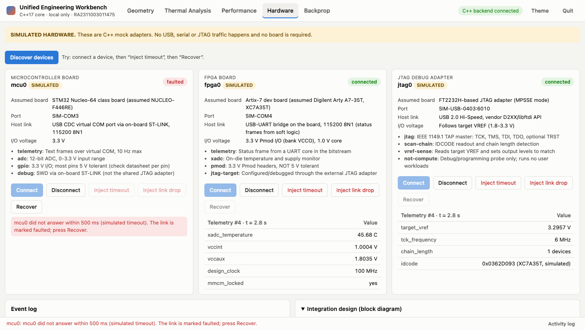

### 12 hardware recovered (t = 19.2 s)

Recover: mcu0 reconnects, telemetry resumes from sequence 1; event log shows the sequence

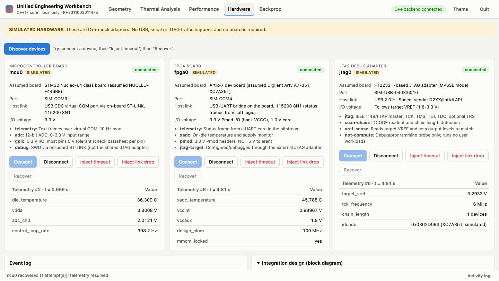

### 13 backprop (t = 20.7 s)

Backprop: forward pass, one update, gradient check (all <= 1e-5) and 100-step loss curve

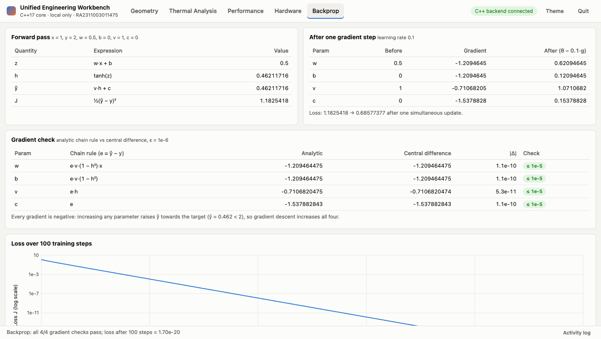

## Server console log for this session

Health checks, telemetry polls and job-status polls are not logged (they repeat every second).

```
Unified Engineering Workbench
  UI:        http://127.0.0.1:8790/
  UI files:  <repo>/src/web
  Examples:  <repo>/data
  Ready in 2.8065 ms (measured from entry of main())
Close this window (or use 'Quit' in the UI) to stop the workbench.

[http] GET /api/system -> 200
[ready] browser UI usable 86.5 ms after page navigation
[http] POST /api/ui-ready -> 200
[http] GET /api/system -> 200
[http] POST /api/geometry/stl -> 200
[http] POST /api/results/nodal -> 200
[http] POST /api/results/nodal -> 400
[http] POST /api/thermal/convergence -> 200
[job] job-0001 started (benchmark)
[http] POST /api/jobs/benchmark -> 200
[job] job-0002 started (batch)
[http] POST /api/jobs/batch -> 200
[job] job-0002 cancel requested
[http] POST /api/jobs/job-0002/cancel -> 200
[hw] discovery (simulated)
[http] POST /api/hw/discover -> 200
[http] POST /api/hw/mcu0/connect -> 200
[http] POST /api/hw/fpga0/connect -> 200
[http] POST /api/hw/jtag0/connect -> 200
[hw] injecting timeout on mcu0
[http] POST /api/hw/mcu0/fault -> 200
[http] GET /api/hw/devices -> 200
[hw] mcu0 recovered after 1 attempt(s)
[http] POST /api/hw/mcu0/recover -> 200
[http] GET /api/backprop -> 200
```

## `Launch --smoke-test` output

```
Unified Engineering Workbench
  UI:        http://127.0.0.1:8765/
  UI files:  <repo>/src/web
  Examples:  <repo>/data
  Ready in 3.00167 ms (measured from entry of main())
  [ok]   GET  /api/health -> 200
  [ok]   GET  / (index.html) -> 200
  [ok]   GET  three.js bundle -> 200
[http] POST /api/thermal/solve -> 200
  [ok]   POST thermal solve (defaults) -> 200
[http] POST /api/thermal/solve -> 400
  [ok]   POST thermal solve N=0 rejected -> 400
[http] POST /api/geometry/stl -> 200
  [ok]   POST example STL -> 200
[http] POST /api/results/nodal -> 200
  [ok]   POST example nodal CSV -> 200
[http] POST /api/results/nodal -> 400
  [ok]   POST malformed CSV rejected -> 400
[hw] discovery (simulated)
[http] POST /api/hw/discover -> 200
  [ok]   POST hardware discovery -> 200
[http] GET /api/backprop -> 200
  [ok]   GET  backprop -> 200
Smoke test passed
Workbench stopped.
```
