# Three solvers, one thermal problem: what the geometry does to the linear algebra

Candidate RA2311003011475 · PASS Science Works R&D internship 2026–27 · Round 2 (solver extension) · November 2026

All numbers and figures in this report come from the C++17 code of the Round 1 workbench, extended for this round (3D mesh and assembly, three solvers, a benchmark harness). Each timed configuration ran in its own process on one core of an Apple M2 (8 cores, 16 GB, Clang 21, `-O3`). Every iterative solve stopped at a true relative residual of 1e-8.

## 1. Summary

The same steady conduction equation, −∇·(k∇T) = q, was solved on two geometries with three solvers built from scratch:

- **Direct:** skyline (envelope) Cholesky, with reverse Cuthill–McKee (RCM) ordering.
- **Stationary:** Gauss–Seidel / SOR, with ω fitted from measurements.
- **Krylov:** conjugate gradient (CG), plain or preconditioned with Jacobi or IC(0).

On the **unit cube**, the solvers behave as textbook theory predicts. On a **finned heat sink** (the Round 1 part, now actually solved), they separate sharply: the condition number is 100–400 times larger at equal size, Gauss–Seidel becomes unusable, and the direct solver's memory hits the wall at about 250 000 unknowns.

<div class="key" markdown="1">
**Which solver wins:**

- **Below about 10⁴ unknowns, or with many load cases on one mesh:** the direct solver. One factorisation, then each extra solve is 10× cheaper than a PCG solve.
- **Above that, or when memory is the limit:** PCG + IC(0). It was fastest or level everywhere, used 0.2–0.4 kB per unknown, and was the only solver whose time grew like n^1.3 on both geometries.
- **SOR** needs only O(n) memory beyond the matrix, but its ω must be tuned per geometry, and it is 5–12× slower than PCG on the heat sink.
- **Gauss–Seidel and Jacobi** are not competitive. On the heat sink, Jacobi diverges.
</div>

| Problem (unknowns) | Skyline Cholesky (RCM) | SOR (fitted ω) | CG | PCG + Jacobi | PCG + IC(0) |
|---|---|---|---|---|---|
| Cube, N = 32 (29 791) | 35.1 s · 370 MB | 0.079 s | 0.028 s | 0.029 s | 0.031 s |
| Cube, N = 128 (2 048 383) | refused: 463 GB | 22.3 s | 7.6 s | 7.8 s | **6.6 s** |
| Heat sink B, 1 mm (37 105) | 2.7 s · 133 MB | 1.37 s | 0.235 s | 0.163 s | **0.159 s** |
| Heat sink B, 0.5 mm (232 875) | 224 s · 2.7 GB | 17.4 s | 2.42 s | 1.59 s | **1.61 s** |
| Heat sink B, 0.25 mm (1 694 364) | refused: 73 GB | 272 s | 35.0 s | 24.2 s | **23.3 s** |

<p class="small">Time = setup + solve, median of 3 runs after a warm-up (a single run when that run took over 2 s). Memory = factor size; the iterative solvers need 1–350 MB. Gauss–Seidel: 163 680 sweeps and 145 s on heat sink B at 1 mm; it hit the 300 s limit at 0.5 mm. Full table: <code>results/round2/solver_runs.csv</code>.</p>

## 2. From Round 1 to Round 2

The notice says Round 1 "solved a simple cube problem". It actually solved a **1D rod**. So this round starts with the cube in 3D, which is the baseline the notice assumes, and checks that it reproduces the Round 1 rod exactly before going further (§5).

The notice also expects that a cube "may yield similar results across all solvers due to linearity". That is true, and it stays true on any geometry:

- For a linear system with a symmetric positive definite (SPD) matrix, every convergent solver approaches **the same discrete solution**. Here they agree to ≤ 3e-9 °C (direct solver) and ≤ 1.3e-4 °C (iterative solvers at a 1e-8 tolerance).
- Changing the geometry cannot make the *answers* differ. What it changes is the **cost and robustness of getting there**: the condition number κ(A), the bandwidth of the matrix, the fill-in, and the iteration counts.

The comparison is therefore about cost, and the geometry is chosen to stress cost.

**Reused from Round 1 (unchanged):**

- the error and cancellation types, the timer, the system-information query and the CSV writer;
- the 1D rod solver, as the reference;
- the STL and nodal-CSV readers and the 3D viewer, which render the results (§3);
- the SVG plot writer.

**New code (all C++17, no external numerical libraries):**

| Module | Purpose |
|---|---|
| `core/mesh` | graded grid, box-union geometry, hexahedral mesh |
| `core/fem3d` | element matrices, assembly, boundary conditions, post-processing, test cases |
| `core/sparse` | CSR matrix, RCM ordering |
| `core/solvers` | the three solvers |
| `tools/solver_study.cpp` | the benchmark harness |
| tests | 43 new unit tests; 96 in total, all passing on macOS and cross-compiled for Windows |

## 3. Problem, discretisation and the two geometries

**Equation and boundary conditions.** Steady conduction −∇·(k∇T) = q, with k constant within each material. Three kinds of boundary are supported:

- **Prescribed temperature (Dirichlet):** eliminated symmetrically from the system (§7.2 shows why not by penalty).
- **Prescribed heat flux** q″.
- **Convection:** a heat loss h_c(T − T∞).

Faces with no condition are insulated.

**Element.** The 8-node trilinear hexahedron on an axis-aligned box a × b × c. Its shape functions are products of 1D hat functions, so the stiffness matrix is exactly a sum of Kronecker products:

K_e = k (S_a⊗M_b⊗M_c + M_a⊗S_b⊗M_c + M_a⊗M_b⊗S_c),  with S_L = (1/L)[[1,−1],[−1,1]] and M_L = (L/6)[[2,1],[1,2]].

A unit test confirms this matches 2×2×2 Gauss quadrature to 1e-12. A useful consequence: the coupling between two nodes along a cell edge, −bc/(9a) + ac/(18b) + ab/(18c), becomes **positive** when the cell is flat in the third direction (here c ≪ a, b). The matrix then stops being an M-matrix, which is the usual warning sign for IC(0) breakdown (§7.4).

**Mesh.**

- A structured, graded Cartesian grid. Every box face and every boundary-region edge is forced to be a grid line, so a union of boxes is represented exactly, with no stair-stepping.
- Cells inside the geometry are kept; nodes are numbered with the axis that has the fewest grid lines varying fastest, which minimises the natural bandwidth.
- Convection adds h_c·(face mass matrix) to the faces it acts on, so the matrix stays SPD with no Dirichlet node at all.
- Storage is CSR with both triangles kept: up to 27 entries per row, about 26 bytes per non-zero.

**Geometry 1: unit cube, manufactured solution.**

- T = 100 + 50·sin πx·sin πy·sin πz + 20x, with k = 10 W/(m·K).
- q is derived analytically from T, and T is prescribed on all six faces, so the discretisation error is known exactly.
- Meshes: N = 8 to 128 cells per side, i.e. 343 to 2 048 383 unknowns.

**Geometry 2: the Round 1 heat sink.**

- **Part:** 60 × 40 × 5 mm aluminium base (k = 200), six fins 2 mm thick and 25 mm tall along y.
- **Load:** a 20 × 20 mm, 50 W chip on the underside (q″ = 125 kW/m²).
- **Cooling:** every other exposed face loses heat to 25 °C air with h_c = 50 W/(m²·K). The rest of the board side is insulated.
- **Variant B** adds a 0.5 mm thermal pad under the chip (k = 3) and a 30 × 30 × 2.5 mm copper spreader (k = 400). That is a conductivity contrast of 133 inside the part, and 4:1 flattened cells in the pad layer.
- **Meshes:** spacing h = 2, 1, 0.5 and 0.25 mm, i.e. 6 132 to 1 694 364 unknowns.

**Why this geometry stresses the solvers (each point is measured in §6–7):**

1. **Thin fins, cooled only by convection.** With no prescribed temperature anywhere, the lowest eigenvalue belongs to an almost uniform temperature field, λ_min ≈ h_c·A_s/n. Aluminium in still air is nearly isothermal (Biot number h_c·L/k ≈ 0.0075), so this eigenvalue is tiny and κ is 100–400× the cube's at the same n.
2. **The fins make the node graph "wide".** With natural numbering, the band has to span a whole fin cross-section and the gaps between fins. The bandwidth, and so the direct solver's memory, depends on the numbering, not just on n.
3. **Variant B** adds coefficient contrast and stretched cells, which a Jacobi-type preconditioner should be able to cancel (§7.4).

<div class="row" markdown="1">
<figure>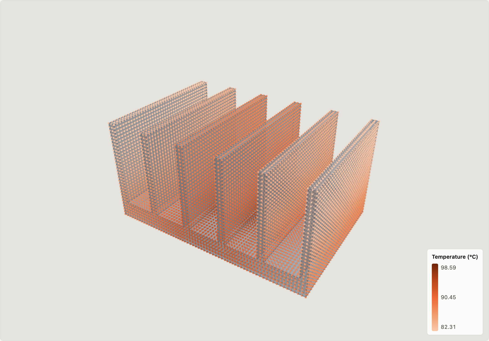<figcaption>Heat sink A at 1 mm: computed surface temperature, 82.3–98.6 °C, rendered in the Round 1 viewer. The central fins, above the chip, are warmest.</figcaption></figure>
<figure>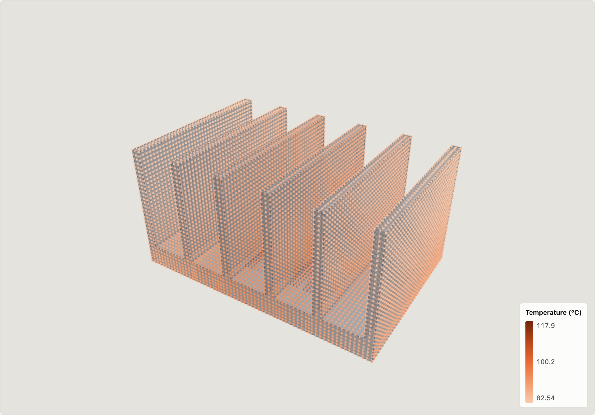<figcaption>Heat sink B at 1 mm: same view, 82.5–117.9 °C. The pad under the chip adds about 19 K at the hot spot. The fins hardly change.</figcaption></figure>
</div>

<div class="row" markdown="1">
<figure>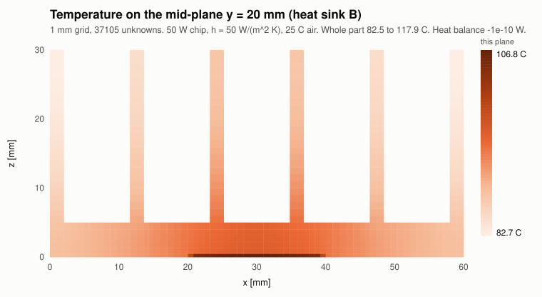<figcaption>Cut through the chip centre, y = 20 mm (heat sink B). The dark band is the 0.5 mm pad, where the temperature gradient is steepest anywhere in the part.</figcaption></figure>
<figure>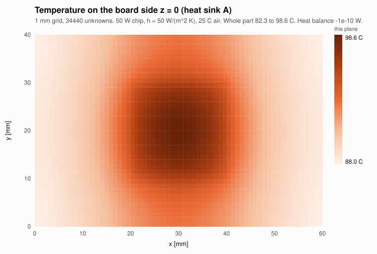<figcaption>Board side, z = 0 (heat sink A): the 20 × 20 mm hot spot under the chip.</figcaption></figure>
</div>

## 4. How each solver was built

All three solvers take the same CSR matrix and right-hand side. They share one cancel token, one stopping rule (true relative residual ‖b − Ax‖/‖b‖ ≤ 1e-8) and one report format: status, iterations, setup and solve time, and bytes allocated.

### 4.1 Direct: skyline Cholesky with RCM ordering

**Storage.** Row i of L is stored from its first non-zero column f_i up to the diagonal. Cholesky creates no fill outside this envelope, so the memory is known *before* factorising:

(profile + n) × 8 bytes, where profile = Σ (i − f_i).

The solver uses this to **refuse** a factorisation that would not fit in a 3 GiB cap, and it reports the predicted size. Four runs ended this way (73–463 GB). That is a result, not a crash.

**Factorisation.** Row by row ("bordering"):

- for each j in the row's envelope: L_ij = (a_ij − Σ_k L_ik L_jk) / L_jj, with k running over the overlap of the two envelopes;
- then L_ii = √(a_ii − Σ_k L_ik²).

The work is Σ (i − f_i)²/2 ≈ n·b²/2 multiply-adds for half-bandwidth b. A non-positive pivot stops the solver with the row number; it never silently produces NaNs. A solve is then one forward and one backward substitution over the envelope.

**Ordering.** Two orderings are compared:

- **Natural:** lexicographic, shortest axis fastest.
- **RCM:** a breadth-first renumbering from a pseudo-peripheral node (George–Liu search), with neighbours visited by increasing degree, applied separately to each disconnected piece of the mesh.

**Predicted cost on an N³ cube:** b ≈ N², so memory grows as n·b ∝ n^5/3 and time as n·b² ∝ n^7/3. Measured: memory slope 1.64, time slope 2.42 (natural ordering) and 2.56 (RCM).

**Why not a general sparse direct solver?** Multifrontal codes with nested-dissection ordering, as used by PARDISO or MUMPS, lower 3D fill to O(n^4/3) and work to O(n²). Implementing one is a project in itself. The envelope solver's n^7/3 growth is exactly the effect such codes are built to avoid, so the comparison here is fair to the *class* of method but not to the state of the art (§9).

<div class="row" markdown="1">
<figure>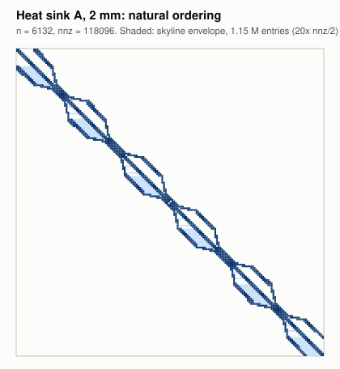<figcaption>Heat sink A, 2 mm, natural ordering. The fins make the band bulge: the envelope holds 1.15 M entries, 20× the non-zeros of the lower triangle.</figcaption></figure>
<figure>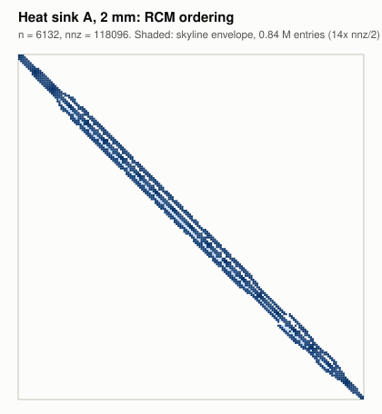<figcaption>RCM ordering of the same matrix: an even band and a 27% smaller envelope. At 1 mm, RCM cuts the envelope 1.8× and the factorisation time 4.7× (9.5 s to 2.0 s).</figcaption></figure>
</div>

**Ordering depends on the geometry.** On the cube, RCM is *worse* than natural ordering (46.1 M against 28.6 M stored entries at N = 32, and 3.4× slower). Lexicographic order on a box is already a near-optimal band, and RCM's level sets are diagonal planes, which hold more nodes. On the heat sink, RCM wins by 1.8× in memory and 4.7× in time. Neither ordering is best everywhere.

### 4.2 Stationary: Gauss–Seidel and SOR

**One sweep.** Update each unknown in order using the newest values:

x_i ← x_i + ω (b_i − Σ_j a_ij x_j) / a_ii.

ω = 1 is Gauss–Seidel. A sweep costs about one matrix-vector product, but it does not produce the residual, so the residual is computed explicitly every 10 sweeps. That check is the only stopping test.

**Divergence detection.** The run stops if the residual grows by 10⁸ or becomes non-finite. Jacobi (all updates from the previous sweep) is included as the baseline.

**Choosing ω.** The textbook optimum, 2/(1 + sin πh), comes from the 7-point finite-difference Laplacian and assumes a "consistent ordering". Our 27-point trilinear matrix has neither property, and the formula over-predicts: 1.45 against 1.31 measured at N = 8, and 1.82 against 1.75 at N = 32.

So ω* was **measured** instead: a golden-section search (4–5 meshes per geometry) minimises the sweeps needed to reach 1e-8. The law 2 − ω* = c·h was then fitted and applied to every level, giving:

- c ≈ 7.0 for the cube (8.1 at N = 32, still drifting);
- c ≈ 17 for heat sink A;
- c ≈ 14 for heat sink B.

This fitted ω gives SOR its expected iteration growth on the cube: about n^0.28, against the theoretical n^1/3. Gauss–Seidel's measured n^0.58 is close to its theoretical n^2/3.

<div class="row" markdown="1">
<figure>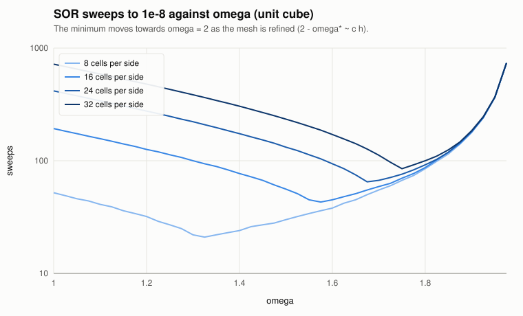<figcaption>Sweeps to 1e-8 against ω on the cube. The minimum is sharp and moves towards 2 as h shrinks. Overshooting costs much less than undershooting by the same amount.</figcaption></figure>
<figure>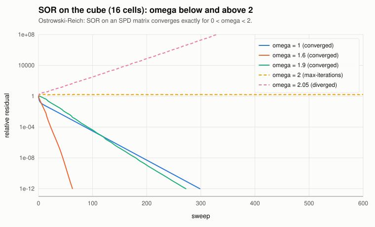<figcaption>The Ostrowski–Reich theorem in practice (cube, N = 16). ω = 1.9 converges; ω = 2 stalls with residual about 1.6 (spectral radius exactly 1); ω = 2.05 diverges.</figcaption></figure>
</div>

### 4.3 Krylov: conjugate gradient, plain and preconditioned

**The iteration.** Textbook (P)CG with the residual updated recursively: r_k+1 = r_k − α A p_k. This costs one matrix-vector product per iteration, plus one preconditioner application.

**Three safeguards:**

- **No trust in the recursive residual.** The true residual b − Ax is recomputed every 25 iterations and *always before declaring convergence*.
- **Residual replacement.** If the recursive residual says "converged" and the true one does not, r is reset to b − Ax and the search direction is restarted. After 5 such restarts the run ends as "stagnated" instead of reporting a false success (§7.1).
- **Breakdown check.** pᵀAp ≤ 0 stops the run as a breakdown: the matrix is not SPD.

**Preconditioners:**

- **Jacobi:** diagonal scaling M = diag(A).
- **IC(0):** an incomplete Cholesky factor L with exactly the sparsity pattern of the lower triangle of A. It is factorised row by row, merging the sorted column lists of rows i and k to form Σ L_ij L_kj. Applying it costs a forward and a backward substitution.
  - If a pivot comes out non-positive, the factorisation restarts on A + α·diag(A), with α = 10⁻³, 2·10⁻³, … (Manteuffel's shift).
  - The smallest pivot ratio, min L_ii²/a_ii, is recorded as a measure of how close IC(0) came to breaking down.

**Condition number at no extra cost.** The CG coefficients α_k and β_k define the Lanczos tridiagonal matrix of M⁻¹A. Its extreme eigenvalues, found by Sturm-sequence bisection, estimate κ from inside. A test on diag(1…60) recovers κ = 60 to 1e-4. All κ values in §6 come from this estimate.

**Cost per iteration** (ns per unknown, flat from 343 to 2 million unknowns):

| Solver | ns per unknown per iteration |
|---|---|
| CG | 15–16 |
| PCG + Jacobi | 16–17 |
| SOR sweep | 25–27 |
| PCG + IC(0) | 31–35 |

The two triangular solves make IC(0) about twice as expensive per iteration as CG. It therefore has to cut iterations by more than 2× to win, and it does: by 2.6× on the cube and 3.0–3.4× on heat sink B.

## 5. Verification

| Check | Result |
|---|---|
| Element matrix: closed form vs 2×2×2 Gauss quadrature | identical to 1e-12 (relative) |
| Patch test: linear field on an irregular graded mesh | reproduced to 1e-9 °C at nodes and in RMS |
| Round 1 rod on a 1 m × 10 mm × 10 mm bar, 80 cells | max nodal error 1.4e-11 °C (nodally exact, as in 1D) |
| Round 1 rod on the cube: centre-of-cell deficit | exactly q·h²/(8k), the Round 1 midpoint error |
| Two materials in series | interface temperature from flux continuity, to 1e-8 °C |
| Manufactured solution, cube N = 8 → 128 | RMS error 0.227 → 8.9e-4 °C: order 2.00 (nodal max: order 2.0) |
| Manufactured solution on the heat-sink domain | order 1.6–2.4 between 2 and 1 mm (cell counts are rounded, so the ratio is not exactly 2) |
| Single fin, root held at 80 °C | tip within 0.004 K of 1D fin theory; root heat 5.664 W against 5.665 W (0.01%) |
| Heat sink: heat balance | 50 W in through the chip, 50 W out by convection; imbalance 1e-10 W |
| Mesh convergence of peak temperature | A: 98.48 / 98.59 / 98.62 / 98.64 °C; B: 124.0 / 117.9 / 117.26 / 117.28 °C |
| All solvers against a reference (PCG + IC(0) to 1e-13) | direct ≤ 3.2e-9 °C; iterative ≤ 1.3e-4 °C, below the discretisation error (3.5e-3 °C at N = 64) |

**Two notes on these results:**

- **Heat sink B needs the 1 mm mesh.** Its peak temperature drops by 6 K from 2 mm to 1 mm because at 2 mm the 0.5 mm pad is a single cell thick and badly resolved. Heat sink A has no such layer and is mesh-converged at 2 mm to 0.2 K.
- **The tolerance is deliberately loose.** At 1e-8 relative residual, the iterative solvers' error is 30–100× smaller than the discretisation error. Solving harder would buy accuracy the mesh cannot deliver.

## 6. Results: scaling with problem size

<figure>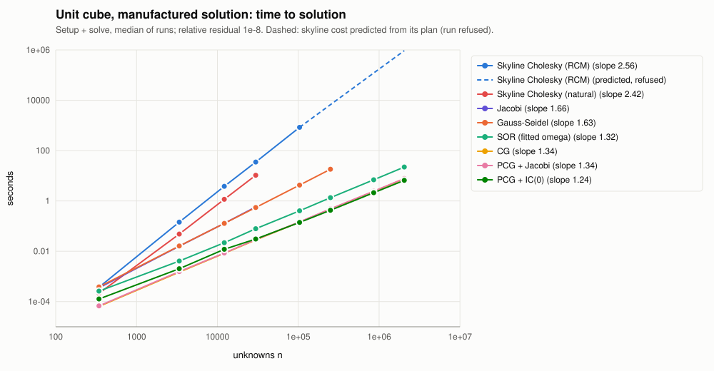<figcaption>Cube: time to solution. Slopes come from a log-log fit. The dashed line extends the skyline solver to the sizes it refused, using its predicted flop count and its measured flop rate (1.1–2.6 GFLOP/s).</figcaption></figure>

<figure>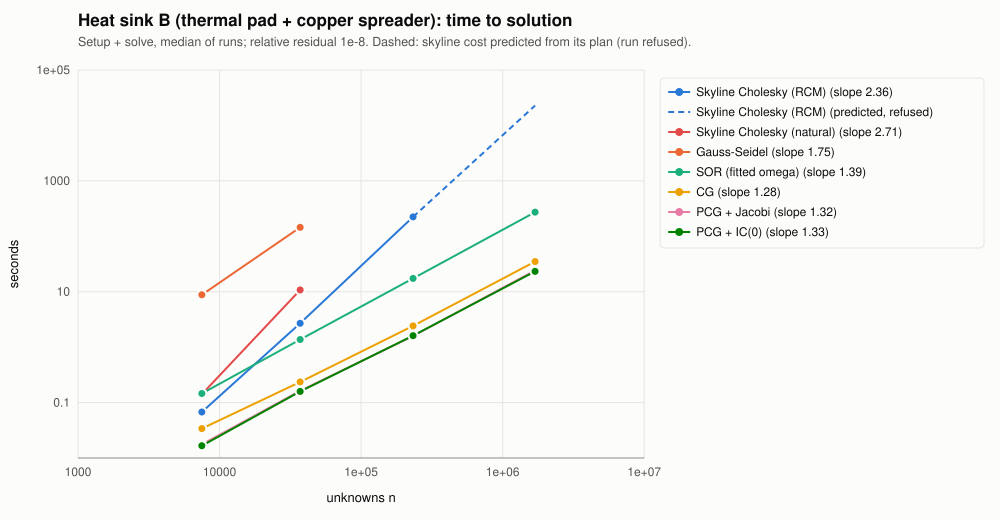<figcaption>Heat sink B: time to solution. Gauss–Seidel starts 100× above SOR and its curve is steeper. PCG + Jacobi and PCG + IC(0) are within 5% of each other and their lines overlap.</figcaption></figure>

<figure>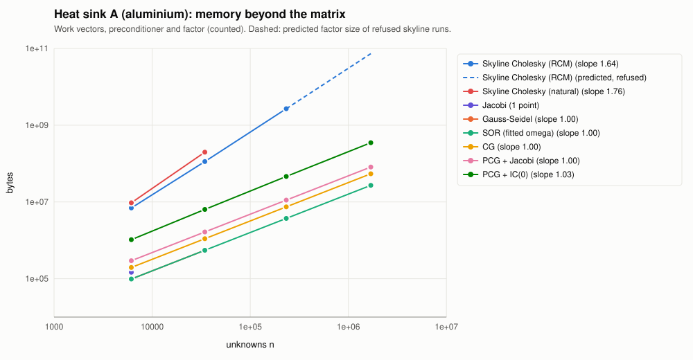<figcaption>Heat sink A: memory beyond the matrix. Direct: slope 1.64 (theory 5/3). Iterative: slope 1.0. At 0.5 mm the factor is 2.7 GB, against 46 MB for IC(0).</figcaption></figure>
<figure>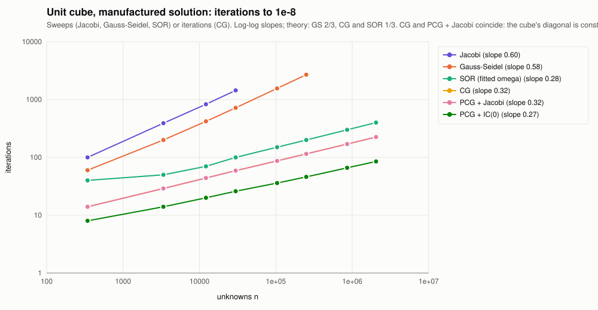<figcaption>Cube iterations. Gauss–Seidel n^0.58 (theory 2/3), SOR n^0.28 and CG n^0.32 (theory 1/3). IC(0) improves the constant (2.6× fewer iterations), not the exponent.</figcaption></figure>

**Reading the time plots.**

- **The direct solver is fast while its band fits in cache.** Its flop rate falls from 2.6 GFLOP/s at n = 343 to 1.1 GFLOP/s at n = 104 k (a 3.1 GB factor).
- **It is competitive only at the smallest sizes.** On heat sink B at 2 mm (7 498 unknowns) it beats SOR (0.068 s against 0.146 s) and is within 4× of PCG. By 37 k unknowns it is 17× slower than PCG + IC(0), and at 104 k unknowns on the cube it takes 841 s against 0.14 s.
- **Its predicted cost for the refused runs:** about 10 days and 463 GB for the 2 M-unknown cube, and about 7 hours but 73 GB for the 0.25 mm heat sink. For the heat sink, memory is the binding limit, not time.
- **The iterative methods all follow n^1.24–1.42,** close to the theoretical n^4/3, which is iterations ∝ h⁻¹ times work ∝ n per iteration.

**Assembly is never the bottleneck:** 2.8 s for the 2 M-unknown cube, against 6.6 s for the fastest solve.

## 7. What the geometry did to conditioning, and four pitfalls

### 7.1 Condition number: two closed forms that match the measurements

<figure>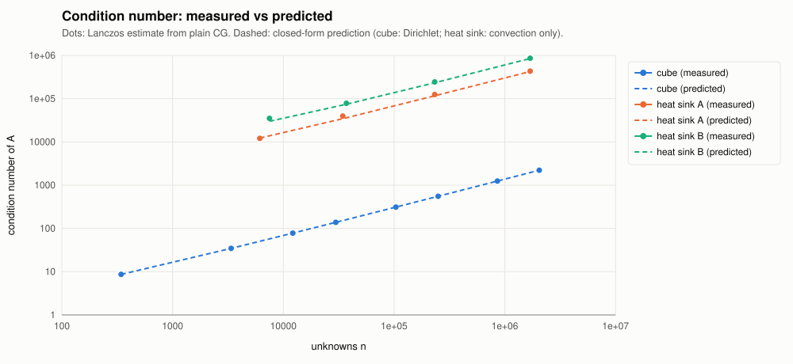<figcaption>κ(A) estimated from CG's Lanczos coefficients (dots) against the closed-form predictions (dashed lines). The heat sinks sit two orders of magnitude above the cube at the same n, and both laws hold over four decades.</figcaption></figure>

**Cube, prescribed temperature on all faces.** The extreme modes are sines:

- λ_max → 4kh (measured 4.00·kh at N = 128);
- λ_min → 3π²kh³ (measured ratio 1.000);
- so κ = 4/(3π²h²) ≈ 0.135·N², which gives 2 213 at N = 128, exactly what was measured.

**Heat sink, convection only.** Take the uniform vector v = 1. Conduction contributes nothing to vᵀAv, because a uniform temperature conducts no heat; only convection does, giving vᵀAv = h_c·A_s. So:

- λ_min ≤ h_c·A_s/n, and the measured value is 0.99× this bound on every mesh. The slowest mode really is "the whole part heats up together", because aluminium in still air is nearly isothermal.
- λ_max ≈ 4·k_max·h, where k_max is 400 in variant B, the copper.
- Together: κ ≈ 4·k_max·h·n/(h_c·A_s) ∝ 1/(Biot·h²). That predicts 12 264 at 2 mm for heat sink A; measured 12 071.

This is the physical reason the heat sink is hard. A good conductor that loses heat weakly has one very slow mode. A solver that only passes information between neighbouring nodes, like Gauss–Seidel, needs on the order of κ sweeps to move that mode: 163 680 sweeps at 1 mm, where the cube at a similar n needs 720.

CG handles it far better than the bound √κ·ln(2/ε)/2 suggests: about 1.4·√κ iterations on the heat sink, against 4.8·√κ on the cube. The slow mode is a single eigenvalue well separated from the others, and CG removes such an isolated eigenvalue in a few iterations.

### 7.2 Pitfall: prescribing temperature with a penalty instead of eliminating it

Setting K_ii += P and b_i += P·T_i at each fixed node is a common shortcut; it keeps the matrix size unchanged. Its effect on the cube (N = 16), with plain CG stopped at 1e-8:

| P / max diagonal | κ (300-step Lanczos) | CG iterations | Max error vs elimination |
|---|---|---|---|
| — (symmetric elimination) | 34.6 | 29 | 0 |
| 10² | 2.4e3 | 43 | 0.041 °C |
| 10⁴ | 2.3e5 | 34 | 0.048 °C |
| 10⁶ | 2.3e7 | 21 | 5.2 °C |
| 10⁸ – 10¹² | 2.3e9 – 2.3e13 | **1** | **160.6 °C** |

<figure>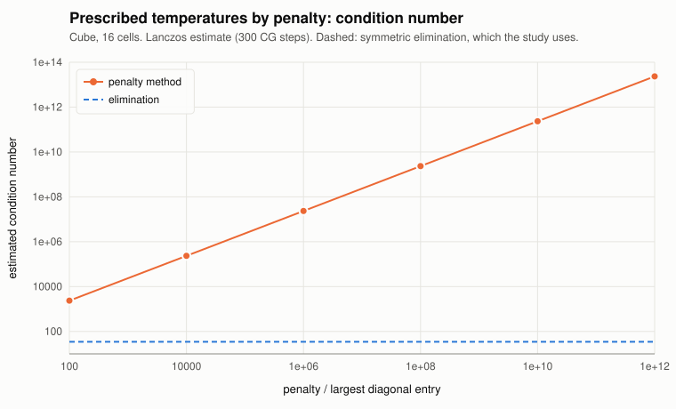<figcaption>κ grows exactly in proportion to P. With a large P, CG reports "converged" after one iteration while the interior is 160 °C wrong.</figcaption></figure>

A small P leaves an O(1/P) boundary error. A large P makes ‖b‖ dominated by the penalty rows, so a 1e-8 *relative* residual is met once the boundary values are right and the interior is not. The run reports success; only comparing it with another solution reveals the error.

### 7.3 Pitfall: trusting the residual you didn't compute

<figure>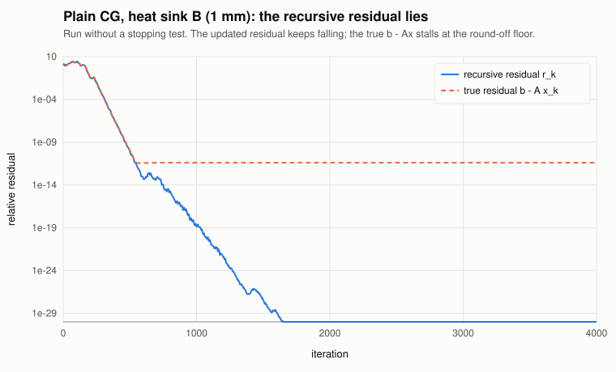<figcaption>Plain CG on heat sink B at 1 mm, never stopped. The recursive residual falls to 1e-74; the true residual b − Ax stops at 4.0e-12.</figcaption></figure>

In floating point, the recursive residual slowly drifts away from b − Ax. An earlier version of the solver checked the true residual but did not replace the recursive one. On heat sink B at 2 mm with a 1e-12 tolerance, the recursive residual reached the tolerance at about iteration 440, while the true one was 1.4e-12. The solver then chased that drifted residual for **9 800 more iterations until the search direction underflowed** ("breakdown").

With residual replacement, the same solve converges in 440 iterations. Asking for less than the round-off floor (1e-17) now ends as "stagnated" with the true residual, not as a false success. Both behaviours are unit tests.

### 7.4 Pitfall predicted, then not found: IC(0) breakdown on stretched cells

The plan said flattened cells (positive off-diagonal entries, so not an M-matrix) would break IC(0). **They did not.** IC(0) factorised without a shift in all 36 configurations tried, including:

- flattened and elongated cells up to 64:1;
- natural, RCM and random orderings;
- meshes up to 1.8 M unknowns;
- pad conductivity lowered by up to 10⁶.

The smallest pivot ratio stayed at 0.44 or above, where 0 would be breakdown:

| Case | Aspect | n | Min pivot ratio | PCG + IC(0) iterations | PCG + Jacobi iterations | CG iterations |
|---|---|---|---|---|---|---|
| cube, flat cells | 1 / 16 / 64 | 1 331 / 23 111 / 92 807 | 0.97 / 0.51 / 0.45 | 11 / 10 / 9 | 22 / 374 / 1 390 | 22 / 374 / 1 390 |
| cube, long cells | 4 / 16 | 6 727 / 112 903 | 0.87 / 0.84 | 22 / 74 | 66 / 252 | 66 / 252 |
| heat sink B, pad k = 200/c, c = 1 / 10² / 10⁴ / 10⁶ | 4 | 22 402 | 0.44 (all) | 63 (all) | 429 / 430 / 430 / 430 | 746 / 855 / 2 586 / 5 882 |

**Why IC(0) holds up.** On flattened cells, the strong coupling is across the thin direction, and IC(0) captures it almost exactly, much like a line solver would. The positive in-plane couplings are weak by comparison, so the entries IC(0) drops are small. The shift code is still needed in general. A random search over 4-node cycle matrices found SPD matrices (their full Cholesky succeeds) on which IC(0) fails at the last pivot (−1.29 in the first one found); the shift recovered at α = 0.064. A rounded version of such a matrix is a unit test.

**Jacobi cancels the contrast.** As the pad conductivity drops by 10⁶, plain CG needs 8× more iterations, while PCG + Jacobi stays at 430. Diagonal scaling normalises each material's rows, as predicted. IC(0) on flattened cells removes the anisotropy penalty almost completely: 9–11 iterations at every aspect ratio, against 22–1 390 for CG.

### 7.5 Pitfall: Jacobi is not guaranteed for SPD matrices

Gauss–Seidel converges for every SPD matrix. Jacobi converges only if 2D − A is also positive definite, where D is the diagonal. On heat sink B this condition fails: Jacobi diverges within 30–70 sweeps, while Gauss–Seidel on the same matrix converges, slowly. On heat sink A, Jacobi needs 76 710 sweeps at 2 mm and does not converge in 200 000 at 1 mm.

## 8. Trade-off matrix: which solver for which situation

| Situation | Choose | Evidence |
|---|---|---|
| Small model (≲ 10⁴ unknowns), solved once | Any; direct is simplest and needs no tuning | Everything finishes in under 0.2 s. Direct residual 1e-15 to 1e-12, growing with κ·ε as expected |
| Same mesh, many load cases (power maps, transients with a fixed step) | **Skyline Cholesky** | One 2.0 s factorisation, then 0.013 s per solve against 0.13 s for PCG + IC(0) at 1 mm: break-even after 17 solves. At 0.5 mm (218 s factorisation) it takes 290 solves |
| Large model (≳ 10⁵ unknowns) | **PCG + IC(0)** (PCG + Jacobi a close second) | n^1.3 time. At 1.7 M unknowns: 23 s and 350 MB, against a 73 GB factor |
| Memory-bound (embedded, many concurrent jobs) | **PCG + Jacobi** or SOR | O(n) extra memory: 81 MB / 27 MB at 1.7 M unknowns, against 350 MB for IC(0) |
| Ill-conditioned: weak convection, low Biot number | **PCG**, never Gauss–Seidel / Jacobi | κ 10⁴–10⁶. Gauss–Seidel needs 163 k sweeps or times out; Jacobi diverges |
| Strong material contrast | **PCG + Jacobi or IC(0)** | Iterations flat in contrast (430 / 63), against 8× growth for plain CG |
| Stretched / anisotropic cells | **PCG + IC(0)** | 9–11 iterations at any aspect up to 64:1, against 1 390 for CG and Jacobi |
| Must be bitwise reproducible | All of them as built | Fixed summation order; identical results run to run (tested) |
| Many cores (not measured here) | Jacobi preconditioner, or SpMV-based methods | IC(0) and Gauss–Seidel are sequential recurrences; Jacobi and the matrix-vector product parallelise trivially |

**The general lesson.** For small or repeated problems, the direct solver's predictable cost and exactness win. Above roughly 10⁴–10⁵ unknowns in 3D, its fill makes it impractical, and a well-preconditioned Krylov method takes over. The geometry decides where that crossover sits. It shifts with how wide the node graph is (fins move it down) and how ill-conditioned the physics is (low Biot number makes the stationary methods useless, not the direct one).

Commercial codes follow the same split:

- **Sparse direct** (multifrontal, nested dissection) for small and medium models and for linear solves inside nonlinear loops;
- **Preconditioned CG** with algebraic multigrid for large thermal models. Multigrid also removes the h⁻¹ growth in iterations that IC(0) only shrinks.

## 9. Limitations and next steps

- **Single-threaded throughout,** to compare algorithms rather than parallel scaling. A threaded SpMV and Jacobi-PCG would be the first step. IC(0) would need level scheduling or colouring to run in parallel.
- **The envelope solver is the simplest direct method.** Nested dissection with a supernodal or multifrontal factorisation would cut the 3D fill from n^5/3 to n^4/3, which is the honest comparison with a production direct solver.
- **No multigrid.** It is the method that would make iteration counts independent of h.
- **Geometry is limited to unions of axis-aligned boxes** on a structured grid. Curved CAD needs an unstructured tetrahedral mesher. STL voxelisation was planned but not built.
- **Every timing comes from one machine** (Apple M2). Three of the 108 runs were slowed by swapping (other programs were using most of the memory). They were re-run on their own, and the originals are kept in `solver_runs_replaced.csv`. Large-n timings remain sensitive to available memory.
- **The SOR ω law** is fitted on small meshes; the cube constant was still drifting at N = 32.

## Appendix A: reproducing every number

```
cmake -S . -B build -DCMAKE_BUILD_TYPE=Release && cmake --build build -j
./build/wb_tests                       # 96 tests
./build/wb_solvers results/round2      # full study, about 2 h, 3 GB peak
./build/wb_solvers results/round2 --quick   # smoke version, under 1 min
python3 scripts/build_report_pdf.py docs/round2/REPORT_ROUND2.md
```

Outputs in `results/round2/`:

- `solver_runs.csv`: one row per run, 34 columns, including κ, the IC(0) pivot ratio, peak memory and agreement;
- `residual_histories/`, `sor_omega_*.csv`, `dirichlet_penalty.csv`, `cg_residual_drift.csv`, `ic0_robustness.csv`;
- the computed temperature fields in the Round 1 nodal-CSV and STL formats;
- `machine.txt`.

## Appendix B: AI assistance

As in Round 1, this work was done with Claude Code (Anthropic, Claude Opus and Fable models) under my direction. I set the plan, the choice of geometry and solvers, and the requirement that every claim be checked against a measurement. The assistant wrote most of the code and drafted this text.

Every number above was produced by the code and checked; several were *corrected* by checking:

- an over-strict test threshold for RCM;
- the CG breakdown that led to residual replacement;
- a penalty-method chart whose κ came from a one-iteration run;
- three timings distorted by swapping;
- a CSV writer that did not quote commas.

The predicted IC(0) breakdown is reported as not observed, not forced. The full log is in `docs/AI_USAGE_LOG.md`.
